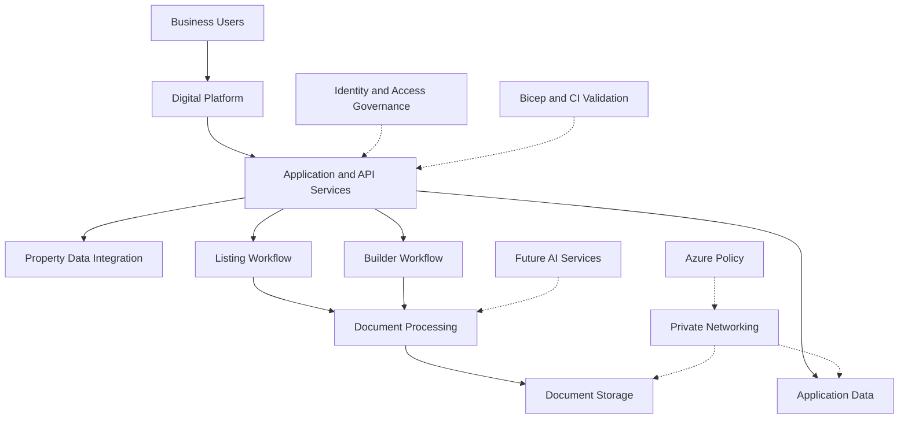
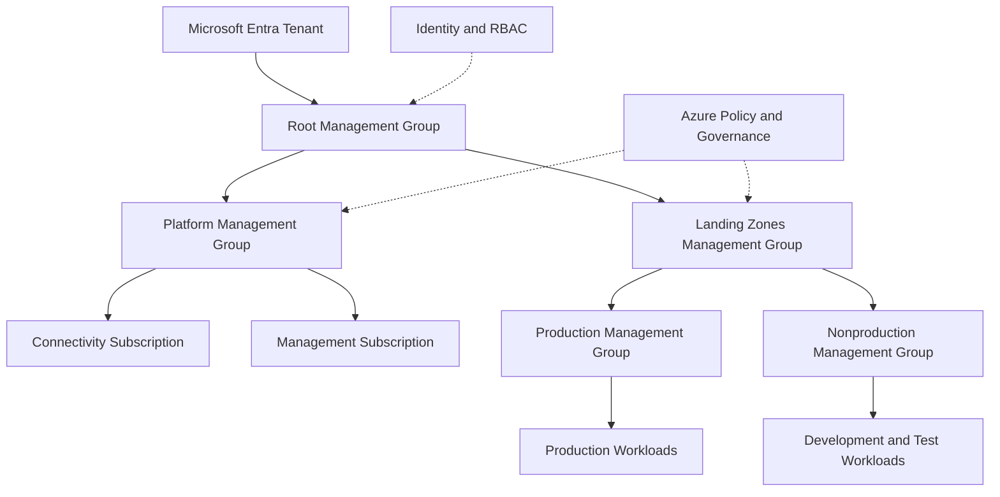

# Azure Enterprise Architecture & Cloud Engineering

## Executive Overview

An independent cloud architecture and engineering portfolio
demonstrating enterprise Azure design, infrastructure automation,
cloud governance, security architecture and deployment validation.

The portfolio combines hands-on engineering exercises with
enterprise architecture principles and modernization patterns.

## Applied Architecture Case Study

### Digital Real Estate Platform Modernization

This portfolio is informed by an independent commercial
digital transformation engagement involving a real estate
technology platform.

The business context includes property information integration,
digital listing workflows, builder-oriented workflows,
document package generation and application modernization.

The architecture work translates business requirements into
secure, scalable and maintainable cloud solution designs.

### Business and Technology Alignment

| Business Capability | Reference Architecture Approach |
|---|---|
| Property information integration | API-driven integration |
| Listing package generation | Document processing services |
| Builder package generation | Reusable workflow components |
| Document management | Azure Blob Storage architecture |
| Application hosting | App Service or Container Apps |
| Secure service connectivity | Managed identity and RBAC |
| Network isolation | Virtual networks and Private Link |
| Infrastructure automation | Azure Bicep |
| Deployment quality | GitHub Actions validation |
| Cloud governance | Azure Policy and security guardrails |
| Operational continuity | Backup and recovery architecture |
| Future intelligent automation | AI-assisted document processing |

### Conceptual Target-State Architecture

### Architecture and Engineering Scope

The work combines three distinct areas:

1. Commercial solution discovery and architecture design.
2. Reference architecture development informed by business needs.
3. Independent hands-on engineering and validation exercises.

The reference engineering workspace explores Azure governance,
networking, infrastructure as code, private connectivity,
identity, application hosting and secure deployment practices.

These exercises support architecture decision-making and
technical feasibility assessment.

They are not represented as completed customer production
deployments.

### Confidentiality

The commercial engagement is anonymized.

Customer source code, proprietary business documents,
customer identifiers and production configuration are
excluded from this portfolio.

All public engineering examples must be independently owned
or explicitly authorized for publication.

## Architecture Objectives

- Establish scalable cloud governance foundations.
- Design secure and isolated workload environments.
- Standardize infrastructure through reusable Bicep templates.
- Incorporate architecture governance into delivery pipelines.
- Support regional deployment and data residency requirements.
- Improve deployment consistency through automated validation.
- Establish repeatable architecture and engineering practices.

## Enterprise Landing Zone Reference Architecture

This diagram represents a conceptual enterprise reference
architecture, not an assertion of a deployed production environment.

## Technical Architecture Domains

| Domain | Engineering and Design Scope |
|---|---|
| Governance | Azure Policy, assignments and initiatives |
| Landing zones | Management groups and subscription organization |
| Networking | Virtual networks and network security groups |
| Private connectivity | Private DNS and virtual network links |
| Identity | Microsoft Entra ID, RBAC and managed identities |
| Infrastructure as Code | Bicep and parameterized deployments |
| DevSecOps | GitHub Actions and infrastructure validation |
| Data residency | Regional governance and policy controls |
| Storage | Storage architecture and lifecycle design |
| Resilience | Backup, recovery and disaster recovery patterns |
| Modernization | App Service and container-based architecture |

## Engineering Evidence

The underlying independent engineering workspace includes:

- Bicep infrastructure and governance templates.
- Custom Azure Policy definitions.
- Policy assignments and policy initiatives.
- Virtual network and network security group definitions.
- Private DNS zone and virtual network link definitions.
- Parameterized infrastructure configurations.
- PowerShell automation utilities.
- GitHub Actions infrastructure validation experience.
- An 18-chapter Azure architecture study and lab notebook.

Only reviewed and approved artifacts will be included in
this public portfolio.

## Architecture Governance Approach

The architecture emphasizes:

1. Business and technical requirements.
2. Current-state assessment.
3. Target-state architecture.
4. Transitional architecture and implementation roadmaps.
5. Security and governance requirements.
6. Architecture decision records.
7. Automated engineering validation.
8. Operational readiness and continuous improvement.

## Infrastructure Delivery Lifecycle

```mermaid
flowchart LR
    A[Requirements] --> B[Architecture Design]
    B --> C[Bicep Development]
    C --> D[Pull Request]
    D --> E[Lint and Build]
    E --> F[Deployment Validation]
    F --> G[What-if Review]
    G --> H[Approval]
    H --> I[Controlled Deployment]
    I --> J[Operational Validation]
```

This is the proposed reference delivery lifecycle.
Individual validation and deployment stages must be evidenced
separately before being described as implemented.

## Portfolio Structure

- infrastructure: Reviewed infrastructure reference templates.
- architecture: Enterprise architecture design documentation.
- decisions: Architecture decision records.
- automation: Engineering automation examples.
- validation: Build and validation evidence.
- .github/workflows: Infrastructure quality gates.

## Experience Classification

This repository represents independent architecture study,
engineering labs and reference implementations.

It complements professional experience in technology leadership,
enterprise transformation, integration, automation and governance.

It does not represent a customer production environment.

## Author

Sachin Tewari

Enterprise Architecture | Technology Transformation |
Cloud Engineering | Intelligent Automation | Innovation

GitHub: https://github.com/mailforsachin

LinkedIn: https://www.linkedin.com/in/tewarisachin/

## Intellectual Property

No customer source code, confidential documents, credentials
or operational data are intended for inclusion.

Public visibility does not constitute an open-source license.

## Architecture Documentation and Engineering Evidence

- [Digital Platform Reference Architecture](architecture/digital-platform-reference.md)
- [Architecture Decision Records](decisions/README.md)
- [Local Validation Evidence](validation/local-validation.md)

### Engineering Quality

| Quality Gate | Local Result |
|---|---|
| Bicep templates | 7/7 passed |
| Parameter files | 3/3 passed |
| Architecture decision records | 12 |
| Compiler warnings | 0 |
| Gitleaks | PASS |
| Azure deployment | None |
| Remote CI | Pending verification |
