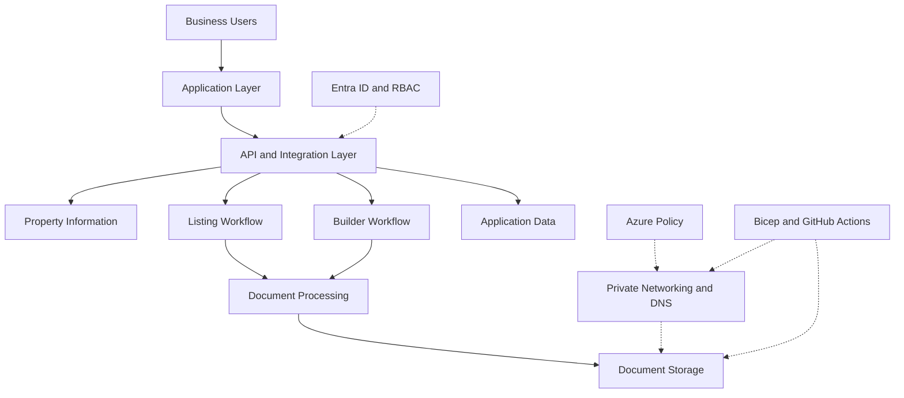

# Digital Platform Reference Architecture

## Executive Overview

An anonymized commercial digital real estate platform
provides the business context for reusable Azure
architecture and independent infrastructure engineering.

The architecture separates business workflows, application
services, integration, document processing and cloud
infrastructure.

## Logical Architecture

## Implementation Boundaries

| Component | Status |
|---|---|
| Application hosting | Proposed |
| API integration | Reference design |
| Document processing | Proposed |
| Storage foundation | Bicep implementation |
| Network segmentation | Bicep implementation |
| Private DNS | Bicep implementation |
| Private endpoints | Proposed |
| Managed identity and RBAC | Proposed |
| Azure Policy | Bicep implementation |
| Local validation | Passed |
| Remote CI | Configured, pending verification |
| Backup and recovery | Proposed |

## Security Considerations

The storage foundation requires HTTPS and TLS 1.2
and disables anonymous blob access and shared keys.

Public network access remains enabled.
Network security groups contain no custom rules.
Private DNS does not itself create private endpoints.

Production adoption requires additional controls
and runtime security validation.

## Regional Strategy

Canadian regional configurations are independent
reference examples, not commercial deployment requirements.

## Modernization Roadmap

1. Business discovery and functional requirements.
2. Current-state and target-state architecture.
3. Integration and document workflow design.
4. Infrastructure and security foundation.
5. Application implementation and testing.
6. Operational readiness and controlled deployment.
7. Continuous improvement and intelligent automation.

This is a proposed delivery roadmap, not a completed
commercial implementation.

## Governance

See [Architecture Decision Records](../decisions/README.md).

## Production Readiness

Deployment requires approved architecture, security,
identity, networking, monitoring and recovery controls.